  

  
  
  
  
  
  

<h1 align="center">Awesome Data Privacy 🛡️🔐</h1>

  <strong>A comprehensive, production-grade index of Enterprise Data Privacy SaaS solutions, Open-Source Privacy Engineering tools, Differential Privacy libraries, Consent Management Platforms (CMP), and compliance automation frameworks (GDPR, CCPA/CPRA, HIPAA, ISO 27701, DPDP).</strong>

---

## 📑 Table of Contents
- [🌐 Sector Overview & Market Dynamics](#-sector-overview--market-dynamics)
- [🏢 Enterprise SaaS Solutions](#-enterprise-saas-solutions)
  - [SaaS Pricing & Valuation Benchmark Table](#saas-pricing--valuation-benchmark-table)
- [💻 Open-Source Data Privacy Software](#-open-source-data-privacy-software)
  - [Ranked Open-Source Repositories](#ranked-open-source-repositories)
- [📚 Regulatory Frameworks & Compliance Guides](#-regulatory-frameworks--compliance-guides)
- [🤝 Contributing](#-contributing)
- [💖 Support](#-support)
- [⭐ Star History](#star-history)
- [📄 License](#-license)

---

## 🌐 Sector Overview & Market Dynamics

The global data privacy software market is estimated at **$4.8B to $6.6B in 2025** (projected to surpass $25B–$30B by 2030 at a ~35–40% CAGR), driven by heightened multi-jurisdictional enforcement (GDPR, CCPA/CPRA, India DPDP, EU AI Act) and rapid enterprise migration to generative AI and DSPM (Data Security Posture Management). 

The industry displays a **hybrid competitive structure**: it is **moderately concentrated at the top tier**—where a handful of enterprise titans and unified GRC suites (e.g., OneTrust, BigID, ServiceNow) control large enterprise vendor-consolidation budgets—while remaining **highly fragmented across mid-market point solutions and emerging developer niches** (such as API-first consent orchestration, differential privacy runtimes, and continuous PII redaction).

---

## 🏢 Enterprise SaaS Solutions

Enterprise data privacy platforms automate privacy governance across complex architectures, managing continuous sensitive data discovery, Data Subject Access Requests (DSAR/DSR fulfillment), cookie consent compliance, and Record of Processing Activities (ROPA).

### SaaS Pricing & Valuation Benchmark Table

All SaaS vendors below are ranked in descending order by enterprise company size (market valuation / annual recurring revenue benchmarks):

| Company / Product | Category / Focus | Company Size (Valuation / ARR) | Starting Tier Pricing | Free Tier / Free Trial Limits | Key Capabilities |
| :--- | :--- | :--- | :--- | :--- | :--- |
| **[ServiceNow Privacy Management](https://www.servicenow.com/products/privacy-management.html)** 🏢 | Enterprise GRC & Integrated Risk | **$180B+ Public Mkt Cap** (~$10B+ ARR) | **~$10,000/yr** (licensed per fulfiller/agent via IRM suite quote) | **No public free tier**; Scoped proof-of-concept (PoC) / sandbox demo available upon enterprise sales request | Native enterprise workflow automation, automated ROPA, privacy assessments, and CMDB data asset lineage |
| **[OneTrust](https://www.onetrust.com/)** 🛡️ | All-in-One Trust Intelligence & GRC | **$4.5B Valuation** ($500M+ ARR) | **$10,000 to $12,000/yr** (~$800–$1,000/mo entry per module via Vendr benchmark) | **14-day free trial** for Cookie Consent / App Compliance (capped at 1 domain and basic web crawler scans) | Comprehensive modular platform: Consent, DSAR, Privacy Ops, Vendor Risk, DSPM, and AI Governance |
| **[BigID](https://bigid.com/)** 🔍 | Data Intelligence, Privacy & DSPM | **$1.0B+ Valuation** (~$100M ARR) | **$175,000/yr** (AWS Marketplace Discovery Foundation 12-month baseline contract) | **No public free tier**; Guided 30-day proof-of-concept (PoC) / risk assessment trial via enterprise private offer | Deep ML/NLP automated sensitive data discovery, classification, data access rights, and DSPM across petabyte-scale data lakes |
| **[TrustArc](https://trustarc.com/)** 📜 | Privacy Management & Assurance | **$60M–$80M ARR** (Acquired by Main Capital) | **$10,000 to $15,000/yr** (Arc Privacy Studio entry tier benchmark) | **14-day free trial** for Cookie Consent Manager; Guided PoC for Arc Privacy Management Studio upon sales consult | Regulatory intelligence engine, automated data mapping, privacy impact assessments (PIA/DPIA), and third-party risk tracking |
| **[DataGrail](https://www.datagrail.com/)** ⚡ | Modern Privacy Automation & DSR | **$100M–$250M Valuation** (~$15M–$18M ARR) | **$36,000/yr** (Standard mid-market subscription package via marketplace benchmarks) | **No public free tier**; Guided sandbox demo and pilot trial provided upon enterprise sales engagement | Live Data Map with 1,500+ pre-built SaaS connectors, 100% automated Request Manager (DSAR), and zero-code consent |
| **[Transcend](https://transcend.io/)** 🚀 | Developer-First Privacy Infrastructure | **$90M Total Raised** (Growth Stage) | **$10,000/yr** (Starting tier for automated DSR / Consent modules) | **No public free tier**; Provisioned developer sandbox / synthetic environment pilot upon sales team consultation | Sombra end-to-end zero-knowledge security gateway, programmatic data subject deletion/export pipelines, telemetry consent |
| **[Ketch](https://www.ketch.com/)** 🌐 | API-First Data Governance & CMP | **$100M–$250M Valuation** (~$9M ARR) | **$150/mo** ($1,800/yr on Starter Tier) | **Free Forever Plan**: Capped at **5,000 Monthly Unique Users (MAUs)**, up to 2 native integrations, full CMP banner, and preference center | Programmatic consent enforcement, dynamic infrastructure orchestration, automated DSR workflows, and cookie scanning |

---

## 💻 Open-Source Data Privacy Software

Open-source privacy engineering tools empower developers, security engineers, and data scientists to embed privacy-by-design into codebases, sanitize datasets, enforce granular consent, and compute on encrypted or anonymized data.

### Ranked Open-Source Repositories

Ranked in descending order by GitHub stargazers count:

| Repository & Creator | Primary Focus / Technology | GitHub Stargazers Badge | Description & Highlights |
| :--- | :--- | :---: | :--- |
| **[Presidio](https://github.com/data-privacy-stack/presidio)** (Data Privacy Stack / Microsoft) | PII Detection, Anonymization & Redaction (Python / C#) |  | Fast, context-aware framework for detecting, redacting, masking, and anonymizing sensitive PII across raw text, scanned images, documents, and structured database pipelines. |
| **[PySyft](https://github.com/OpenMined/PySyft)** (OpenMined) | Confidential Computing & Remote Data Science (Python) |  | Open-source framework enabling secure, private computation and federated data science on non-public data using Differential Privacy, Homomorphic Encryption, and secure enclaves. |
| **[immudb](https://github.com/codenotary/immudb)** (Codenotary) | Immutable & Tamperproof Audit Logging (Go) |  | Lightweight, cryptographically verifiable database with zero-trust architecture, providing tamper-proof audit trails and immutable history required for strict GDPR/HIPAA compliance logs. |
| **[CookieConsent](https://github.com/orestbida/cookieconsent)** (Orest Bida) | Lightweight GDPR/CCPA Consent Management (JavaScript) |  | Blazing-fast, cross-browser, vanilla JavaScript cookie consent banner and preference center with zero dependencies, WCAG accessible, and built-in Google Consent Mode v2 support. |
| **[CISO Assistant](https://github.com/intuitem/ciso-assistant-community)** (Intuitem) | Community GRC & Privacy Risk Management (Python / Django) |  | One-stop open-source GRC platform automating risk management, compliance auditing, and DPIA/PIA mapping across 200+ global frameworks including GDPR, ISO 27701, and NIST Privacy. |
| **[Google Differential Privacy](https://github.com/google/differential-privacy)** (Google) | Differential Privacy Libraries (C++ / Go / Java) |  | Production-grade libraries containing privacy-preserving building blocks, ε-differential privacy aggregations, SQL query engines, and statistical noise mechanisms developed by Google. |
| **[Bearer CLI](https://github.com/Bearer/bearer)** (Bearer) | Static Code Analysis for Privacy & Sensitive Data (Go) |  | Static application security testing (SAST) tool specifically built to scan codebases, discover sensitive data flows, trace third-party API data sharing, and flag privacy violations before production. |
| **[Opacus](https://github.com/meta-pytorch/opacus)** (Meta PyTorch) | Differentially Private Deep Learning (Python / PyTorch) |  | High-speed library that trains PyTorch neural networks with Differential Privacy (DP-SGD), offering rigorous mathematical privacy guarantees for sensitive training datasets. |
| **[Diffprivlib](https://github.com/IBM/differential-privacy-library)** (IBM Research) | Differential Privacy Machine Learning (Python / Scikit-learn) |  | Flexible Python library for experimenting with and implementing differential privacy in data analysis and machine learning, featuring drop-in estimators compatible with scikit-learn. |
| **[Fides](https://github.com/ethyca/fides)** (Ethyca) | Privacy as Code & Consent Infrastructure (Python / React) |  | The open-source privacy engineering and compliance platform. Provides programmable data mapping (Privacy as Code via CI/CD), automated DSR orchestration, and consent banner delivery. |
| **[Open-Pryv.io](https://github.com/pryv/open-pryv.io)** (Pryv) | Personal Data Vault & Consent Middleware (Node.js) |  | Scalable, open-source personal data management platform and backend vault engineered to manage sensitive personal, clinical, and IoT data with granular auditability and consent control. |

---

## 📚 Regulatory Frameworks & Compliance Guides

Ensure your privacy architecture meets key global requirements:

- **🇪🇺 GDPR (General Data Protection Regulation):** Emphasizes lawful basis for processing, data minimization, privacy-by-design (Art. 25), and strict 72-hour breach notifications (Art. 33).
- **🇺🇸 CCPA / CPRA (California Consumer Privacy Act):** Mandates consumer opt-outs for data selling/sharing, explicit 'Limit Use of Sensitive Personal Info' controls, and auditable DSAR processes.
- **🇮🇳 DPDP Act (Digital Personal Data Protection Act):** Focuses on clear and unconditional consent notices, data fiduciary obligations, and specialized protections for children's data.
- **🏥 HIPAA (Health Insurance Portability and Accountability Act):** Strict governance, Safe Harbor, and Expert Determination de-identification rules for Protected Health Information (PHI).
- **🔒 ISO/IEC 27701:** International standard extension to ISO/IEC 27001 providing specific implementation guidance for Privacy Information Management Systems (PIMS).

---

## 🤝 Contributing

Contributions are warmly welcomed! 💖

1. 🍴 Fork the repository.
2. 🌿 Create a descriptive feature branch (`git checkout -b feature/add-new-privacy-tool`).
3. 📝 Add your entry with specific pricing/free-tier details (for SaaS) or GitHub star count badges (for Open Source).
4. ✅ Ensure proper formatting and markdown link integrity.
5. 🚀 Submit a pull request!

---

## 💖 Support

If you find this repository valuable for your work, research, or compliance journey, thank you for supporting the project! You can show your appreciation in several ways:

- ⭐ **Star this repository** to help others discover it on GitHub.
- 🍴 **Fork and contribute** new data privacy tools, benchmarks, and updates.
- 📢 **Share it** with fellow privacy engineers, data protection officers (DPOs), and security researchers.
- ☕ **Buy me a coffee / Sponsor:** Support ongoing maintenance and curated updates directly via the [GitHub Sponsors Dashboard](https://github.com/sponsors/ishandutta2007).

  

---

##  Star History

---

## 📄 License

This repository is distributed under the [MIT License](LICENSE).
